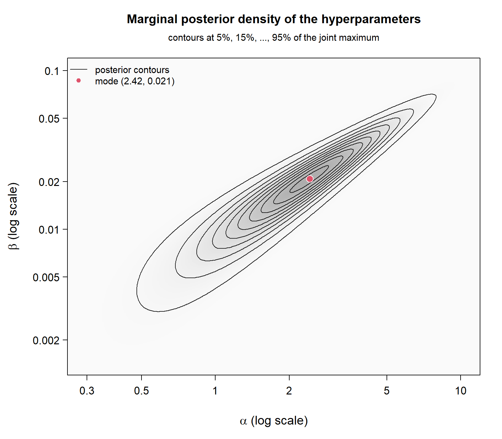
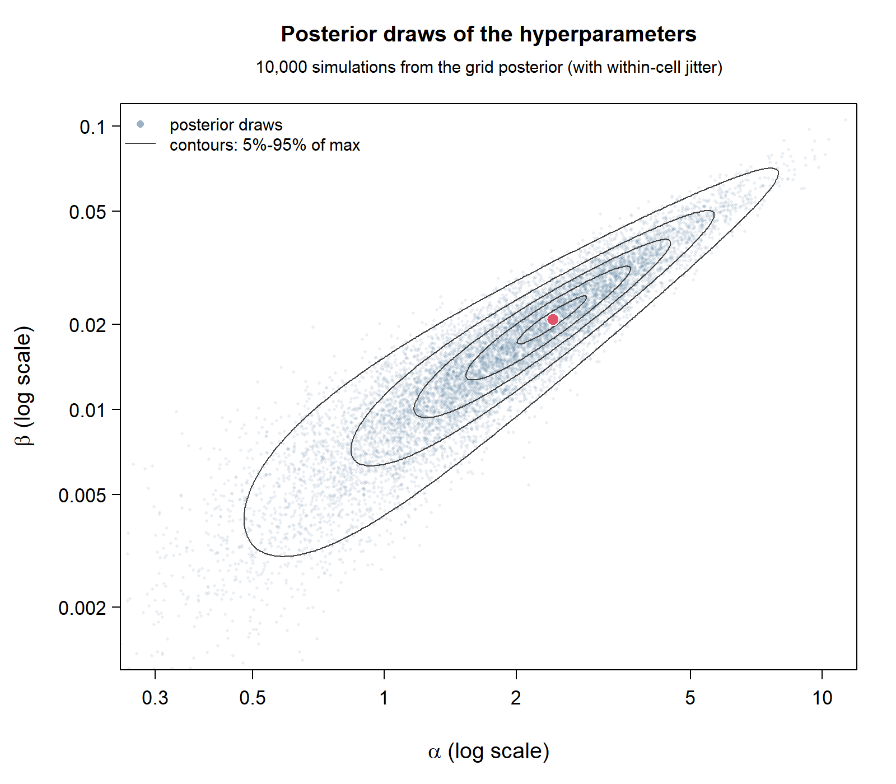
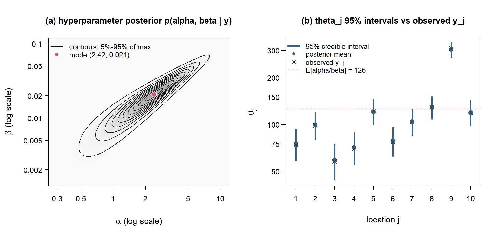

# BDA3 第 5 章 · 练习 13：自行车流量的层次二项模型

> Gelman et al., *Bayesian Data Analysis* (3rd ed.)，Chapter 5, Exercise 13。
> 数据为 Table 3.3 前两行：Berkeley 住宅区中被标记为 "bike route" 的 10 个路口。

本目录用网格法（grid sampling）实现该题的层次二项模型，并在此基础上推导**新组**的
后验预测分布 $p(\tilde y\mid y)$ 及其 95% 可信区间。

> 注：本目录还有同一组交通计数数据的**层次 Poisson 模型**（`Bikes_poisson*.R`），
> 见文末「二、层次 Poisson 模型」。

---

## 1. 文件清单

| 文件 | 说明 |
|---|---|
| `Bikes_new_sample.R` | 主脚本：数据 → log 后验 → 网格 → 后验预测 → 作图 → 95% 区间 |
| `posterior_predictive_new_group.png` | 脚本第 4、6 节生成的图（新组预测分布的直方图 + HPD 区间框） |

脚本本身只把图送到当前图形设备（RStudio 的 Plots 窗格 / 默认设备），上面那张 PNG 是另外
用 `png()` 设备渲染的，不是脚本必需的产物。

---

## 2. 数据

$y_j$ = 该路口的自行车数，$n_j$ = 该路口的总车辆数（含自行车），$j=1,\dots,10$：

| $j$ | 1 | 2 | 3 | 4 | 5 | 6 | 7 | 8 | 9 | 10 |
|---|---|---|---|---|---|---|---|---|---|---|
| $y_j$ | 16 | 9 | 10 | 13 | 19 | 20 | 18 | 17 | 35 | 55 |
| $n_j$ | 74 | 99 | 58 | 70 | 121 | 77 | 104 | 129 | 308 | 119 |
| $y_j/n_j$ | .216 | .091 | .172 | .186 | .157 | .260 | .173 | .132 | .114 | .462 |

合并比例 $212/1159 = 0.183$。

---

## 3. 模型

$$
\begin{aligned}
y_j \mid \theta_j &\sim \mathrm{Binomial}(n_j,\ \theta_j), \\
\theta_j \mid a,b &\sim \mathrm{Beta}(a,b), \\
p(a,b) &\propto (a+b)^{-5/2} \quad\text{（与 §5.3 rat tumor 例题相同的非信息超先验）}.
\end{aligned}
$$

把 $\theta_1,\dots,\theta_{10}$ 解析积掉，得超参数的边际后验（脚本 `logpost4` 计算的正是它）：

$$
p(a,b\mid y)\ \propto\ (a+b)^{-5/2}\prod_{j=1}^{10}\frac{B(a+y_j,\;b+n_j-y_j)}{B(a,b)} .
$$

脚本用 BDA3 的标准重参数化 $u=\mathrm{logit}\!\big(\tfrac{a}{a+b}\big),\ v=\log(a+b)$，
其 Jacobian 为 $\left|\partial(a,b)/\partial(u,v)\right| = ab$，因此 log 后验为

$$
\log p(u,v\mid y)=10\big[\log\Gamma(a+b)-\log\Gamma(a)-\log\Gamma(b)\big]+\log a+\log b
-\tfrac{5}{2}\log(a+b)+\sum_j\big[\log\Gamma(a+y_j)+\log\Gamma(b+n_j-y_j)-\log\Gamma(a+b+n_j)\big].
$$

（二项系数与 $y$ 无关，作为常数略去。）

---

## 4. 脚本结构

| 行号 | 内容 |
|---|---|
| `L1–L4` | 数据 `bikes.y`、`bikes.n` |
| `L5–L14` | `logpost4(u, v)`：$(u,v)$ 尺度上的 log 后验，含 Jacobian 与超先验 |
| `L15–L21` | 网格：$u\in[-2.30,-0.50]$、$v\in[1.00,5.00]$，步长 0.01（181 × 401 = 72 581 点）；`outer` 求值后取 `exp(z - max(z))` |
| `L23` | `contour()` 画联合后验等高线（相对最高点的高度：0.05–0.95） |
| `L25–L58` | **新组后验预测**：① 按 `z2` 的概率从网格抽 $(u,v)$ → 变回 $(a,b)$；② 两阶段抽样 $\phi\sim\mathrm{Beta}(a,b)$、$\tilde y\sim\mathrm{Bin}(100,\phi)$；③ 把 $\phi$ 积分掉得 beta-binomial，对 $(a,b)$ 后验取平均，得到解析的 $p(\tilde y=k\mid y)$ |
| `L60–L72` | 作图：灰柱 = 10 000 次抽样，红竖线 = 解析概率，图例在右上 |
| `L74–L80` | 数值摘要：均值、标准差、分位数、若干点的概率 |
| `L82–L95` | 95% 峰值两侧区间（HPD）：红色虚线框 + 图下方标注 |

随机种子 `set.seed(2024)`，抽样次数 `ndraw = 10000`，新组规模 `n.tilde = 100`。

---

## 5. 主要结果

**超参数后验**：众数在 $u=-1.37,\ v=2.90$，即 $a\approx3.7$、$b\approx14.5$，
总体比例 $\mu=a/(a+b)\approx0.20$。99% 的概率质量落在 $u\in[-1.92,-0.71]$、
$v\in[1.23,4.10]$，因此上面设的网格范围足够（边界外质量约 $10^{-5}$ 量级）。

**各路口 $\theta_j$ 的后验（第 (c) 问的收缩现象）**：

| $j$ | 1 | 2 | 3 | 4 | 5 | 6 | 7 | 8 | 9 | 10 |
|---|---|---|---|---|---|---|---|---|---|---|
| 原始比例 | .216 | .091 | .172 | .186 | .157 | .260 | .173 | .132 | .114 | **.462** |
| 后验均值 | .214 | .107 | .179 | .189 | .163 | .250 | .177 | .140 | .118 | **.429** |
| 后验 sd | .043 | .030 | .044 | .042 | .031 | .045 | .035 | .029 | .018 | .046 |

极端值被拉向总体水平：$0.462\to0.429$、$0.091\to0.107$；$n_j$ 越大收缩越弱
（第 9 个路口 $n=308$，sd 仅 .018）。

**新组预测 $p(\tilde y\mid y)$，$\tilde n=100$**：

| 项目 | 数值 |
|---|---|
| 均值 / 标准差 | 20.78 / 11.94 |
| 2.5% / 中位数 / 97.5% | 3 / 19 / 50 |
| 众数 | $k=16$，$p=0.037$ |
| $P(\tilde y=0)$、$P(\tilde y\leq10)$ | 0.0050、0.1959 |
| **95% 峰值两侧（HPD）** | **[0, 43]**，实际覆盖 95.2% |
| 95% 等尾（2.5% + 97.5%） | [3, 50]，覆盖 95.6% |

两点解读：

1. **HPD 比等尾区间更短且整体左移**。预测分布的左端并不趋于 0（$p(0)=0.0050$ 与
   $p(43)=0.0054$ 几乎等高），所以等高截断会把整条左尾都包含进来，被砍掉的是右侧长尾。
2. **远宽于朴素二项模型**。若把 $\theta$ 当作已知、直接用 $\mathrm{Bin}(100,0.183)$，
   标准差只有 $\sqrt{100\times0.183\times0.817}\approx3.9$，比 11.9 小了三倍多：
   $$
   \mathrm{Var}(\tilde y)=n\,E[\theta(1-\theta)]+n^2\,\mathrm{Var}(\theta),
   $$
   第二项 $n^2\mathrm{Var}(\theta)$ 正是层次模型捕捉到、而普通二项模型忽略的组间异质性。

---

## 6. 如何运行

R 不在 PATH 上，装机路径为 `D:\R-4.5.2`：

```powershell
& 'D:\R-4.5.2\bin\x64\Rscript.exe' --vanilla Bikes_new_sample.R
```

或在 RStudio 中打开 `Bikes_new_sample.R` 后全选运行（`Ctrl+Shift+Enter`）。控制台会依次打印：

```
 mean    sd  q025   q50  q975
20.78 11.94  3.00 19.00 50.00
[1] 0.0050 0.0308 0.0347 0.0188 0.0074
[1] 0.1959
  lower   upper    mass
 0.0000 43.0000  0.9521
```

前两幅图分别是联合后验的等高线（`contour`）和预测分布（`hist` + 红竖线 + 红框）。

---

## 7. 实现要点

- **网格只算一次**。`z`/`z2` 就是后验的数值表示，抽样时直接用 `sample(..., prob = p.joint)`
  按格点概率抽 $(u,v)$，不要重复调用 `outer`。
- **索引偏移**：`k <- 0:100` 而 `p.pred[j]` 存的是 $P(\tilde y=j-1)$，所以第 6 节里
  区间质量要写 `p.pred[(k.lo + 1):(k.hi + 1)]`；写成 `p.pred[k.lo:k.hi]` 会漏掉 $k=0$
  且不报错。
- **两条路径互相验证**：灰柱（两阶段抽样）与红线（解析 beta-binomial）应当重合；
  解析版更光滑，95% 区间就基于它计算。
- **HPD 的 min/max 端点只对单峰分布成立**。本图的预测分布是单峰的，可以直接取端点；
  若出现多峰，`min`/`max` 会高估区间。
- `contour()` 的等高线数值是"相对最高点的高度"，`z2` 未归一化，所以它们是形状参考，
  不是概率值；真正的概率要 `z2 / sum(z2)`（第 36 行即为此）。

---

# 二、层次 Poisson 模型（交通计数）

> 数据：`Traffic_total.txt`；模型：Poisson–Gamma 层次模型；超先验：$p(\alpha,\beta)\propto(\alpha+\beta)^{-5/2}$。
> 脚本：`Bikes_poisson.R`（平先验对照）、`Bikes_poisson_vague.R`（经典先验）、
> `Bikes_poisson_joint.R`（抽 $\theta$ 并画分解图）。

## 1. 数据

`Traffic_total.txt` 只有一行，用中文全角逗号分隔的 10 个计数：

| $j$ | 1 | 2 | 3 | 4 | 5 | 6 | 7 | 8 | 9 | 10 |
|---|---|---|---|---|---|---|---|---|---|---|
| $y_j$ | 74 | 99 | 58 | 70 | 122 | 77 | 104 | 129 | 308 | 119 |

*脚本读文件时直接抽出所有数字，所以全角/半角逗号、空格、换行都不影响。*

## 2. 模型

$$
\begin{aligned}
y_j\mid\theta_j &\sim \mathrm{Poisson}(\theta_j),\\
\theta_j\mid\alpha,\beta &\sim \mathrm{Gamma}(\alpha,\beta),\\
p(\alpha,\beta) &\propto (\alpha+\beta)^{-5/2}.
\end{aligned}
$$

把 $\theta_1,\dots,\theta_{10}$ 解析积掉（Gamma–Poisson 共轭）：

$$
p(\alpha,\beta\mid y)\ \propto\ p(\alpha,\beta)\prod_{j=1}^{10}
\frac{\beta^{\alpha}\,\Gamma(\alpha+y_j)}
     {\Gamma(\alpha)\,y_j!\,(\beta+1)^{\alpha+y_j}} .
$$

给定 $(\alpha,\beta)$ 后，各个 $\theta_j$ 条件独立：

$$
\theta_j\mid\alpha,\beta,y_j \sim \mathrm{Gamma}(\alpha+y_j,\ \beta+1),
$$

因此联合后验可以写成

$$
p(\theta,\alpha,\beta\mid y)
= p(\alpha,\beta\mid y)\prod_{j=1}^{10}p(\theta_j\mid\alpha,\beta,y_j).
$$

这也是后面把“超参数后验”和“$\theta_j$ 区间”分开画的依据。

题目 (b) 的原始要求是：计算超参数的边际后验并画等高线；再从超参数后验中随机抽
$(\alpha,\beta)$、画散点图。后续步骤利用上面的条件后验，对每个抽到的 $(\alpha,\beta)$
再抽 $\theta_j$，从而得到 $(\theta,\alpha,\beta)$ 的联合后验样本。下面三个脚本分别对应
“平先验对照 → 经典先验的等高线/散点 → 抽 $\theta$ 并画分解图” 这几步。

## 3. 脚本与图

| 文件 | 说明 |
|---|---|
| `Bikes_poisson.R` | 平先验 $p(\alpha,\beta)\propto1$ 的对照版：网格 + 超参数等高线 + 后验抽样散点 |
| `hyperparameter_contours.png` / `hyperparameter_scatter.png` | 平先验版的 $(\alpha,\beta)$ 等高线与 10,000 次抽样散点 |
| `Bikes_poisson_vague.R` | 经典先验 $(\alpha+\beta)^{-5/2}$ 版，流程同上；输出带 `_vague` 后缀 |
| `hyperparameter_contours_vague.png` / `hyperparameter_scatter_vague.png` | 经典先验版的两张图 |
| `Bikes_poisson_joint.R` | 从 $p(\alpha,\beta\mid y)$ 抽 1000 个 $(\alpha,\beta)$，再抽 $\theta_j$；画分解图、打印区间表 |
| `joint_theta_alpha_beta_decomp.png` | **当前使用的分解图**：(a) 超参数等高线；(b) 10 个 $\theta_j$ 的 95% 区间 |
| `joint_theta_alpha_beta_2d.png` | 2×2 成对投影预览；未并入脚本 |







## 4. 主要结果

**经典先验 $(\alpha+\beta)^{-5/2}$**（`Bikes_poisson_vague.R`，10,000 次网格抽样）：

| 项目 | 数值 |
|---|---|
| 众数 | $\alpha=2.42,\ \beta=0.0208$，$\alpha/\beta\approx116$ |
| 后验均值 | $\alpha=2.16,\ \beta=0.0186$ |
| 95% 区间 | $\alpha\in[0.48,\ 5.41]$，$\beta\in[0.0032,\ 0.0486]$ |
| $\mathrm{cor}(\log\alpha,\log\beta)$ | 0.92 |

**平先验对照**（`Bikes_poisson.R`）：众数 $\alpha=4.57,\ \beta=0.0394$，
95% 区间 $\alpha\in[1.38,\ 9.03]$、$\beta\in[0.0103,\ 0.0800]$，相关 0.94。
换成经典先验后，$(\alpha,\beta)$ 整体变小、区间更集中。

**$\theta_j$ 的后验**（`Bikes_poisson_joint.R`，1000 次抽样）：

| $j$ | 1 | 2 | 3 | 4 | 5 | 6 | 7 | 8 | 9 | 10 |
|---|---|---|---|---|---|---|---|---|---|---|
| $y_j$ | 74 | 99 | 58 | 70 | 122 | 77 | 104 | 129 | 308 | 119 |
| 后验均值 | 74.66 | 99.41 | 58.72 | 70.95 | 120.77 | 78.07 | 104.24 | 128.62 | 304.46 | 119.12 |
| 95% 下界 | 58.41 | 80.45 | 44.34 | 55.58 | 99.90 | 62.34 | 85.25 | 108.65 | 271.22 | 98.47 |
| 95% 上界 | 93.36 | 119.51 | 74.10 | 88.01 | 144.03 | 96.36 | 125.49 | 150.89 | 337.78 | 142.31 |

$\theta_j$ 与 $\alpha,\beta$ 的边际相关都很小（$|\rho|\lesssim0.18$）：$\theta_j$ 的
方差主要来自 Poisson 噪声，而 $\alpha$、$\beta$ 沿 $\alpha/\beta\approx116$ 的脊线
同向变化，对 $\theta_j$ 的影响大部分相互抵消。这也是为什么单看 $\theta_j$ 对
$\alpha$ 或 $\beta$ 的散点图会像“一团点”。

## 5. 如何运行

```powershell
& 'D:\R-4.5.2\bin\x64\Rscript.exe' --vanilla Bikes_poisson_vague.R
& 'D:\R-4.5.2\bin\x64\Rscript.exe' --vanilla Bikes_poisson_joint.R
```

`Bikes_poisson.R` 是平先验对照版。三个脚本都要求 `Traffic_total.txt` 能被找到：

- `Bikes_poisson_joint.R` 会自动在当前目录、脚本所在目录、上一级目录里查找
  `Total_traffic.txt` / `Traffic_total.txt`，也会匹配 `*traffic*.txt` 并在脚本目录下
  递归找子目录；若仍找不到，可在脚本顶部设置
  `data.file <- "D:/.../Traffic_total.txt"`。
- `Bikes_poisson.R` 与 `Bikes_poisson_vague.R` 直接在**当前工作目录**读取文件；
  运行前先 `setwd("D:/大学/Bayes Statistics/hw5")`，或把数据放到当前目录。

`data.file` 必须写到**文件**，并用正斜杠 `/` 或双反斜杠 `\\`；写成文件夹、或只写单个 `\`，
R 会报 `unrecognized escape`（反斜杠被当成转义符）。

`Bikes_poisson_vague.R` 的图输出到当前工作目录；`Bikes_poisson_joint.R` 的图输出到
脚本所在目录。

## 6. 实现要点

- **网格**：在 $(\log\alpha,\log\beta)$ 上取 520×520 网格。后验是一条很窄的对角脊，
  log 尺度比原始 $(\alpha,\beta)$ 尺度均匀，网格下界取得足够低（$\alpha$ 从 0.1、
  $\beta$ 从 0.0005 起），避免截断尾部。
- **抽样**：把 `z2` 归一化后按格点概率抽 1000 个 $(\alpha,\beta)$，再在格内加均匀抖动，
  否则散点图上会出现网格花纹。
- **$\theta$ 的条件抽样**：
  ```r
  theta.mat <- sapply(y, function(yj)
    rgamma(ndraw, shape = a.draw + yj, rate = b.draw + 1))
  ```
  `theta.mat` 是 1000×10 矩阵，第 $j$ 列是 $\theta_j$ 的 1000 次抽样。
- **为什么用分解图而不是 3D**：$(\theta_j,\alpha,\beta)$ 的静态 3D 散点有遮挡、透视变形
  和尺度差异，读者很难读出密度；联合后验本身又是乘积结构，所以把
  (a) $p(\alpha,\beta\mid y)$ 的等高线和 (b) 10 个 $\theta_j$ 的 95% 区间并排画更清楚。
  (b) 的 $\theta$ 轴用 log 刻度，是因为 $\theta_j$ 从约 44 跨到 338，线性刻度会把小计数的
  区间压扁。
- **先验**：`Bikes_poisson.R` 保留 $p\propto1$ 的平先验结果作对照；
  `Bikes_poisson_vague.R` 与 `Bikes_poisson_joint.R` 使用题目指定的经典先验
  $(\alpha+\beta)^{-5/2}$。
